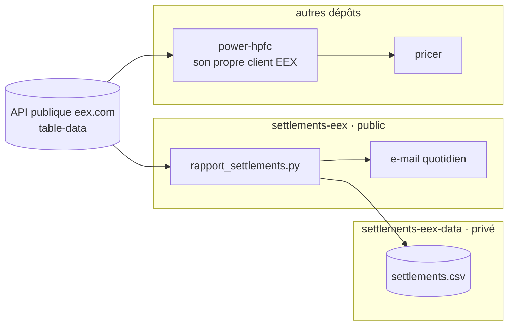

# Notice détaillée — settlements-eex

Cette notice décrit tout ce que fait `settlements-eex` : quels contrats sont suivis, comment les settlements sont
récupérés, contrôlés et stockés, comment l'e-mail est construit, et comment ce dépôt se situe par rapport à
`power-hpfc` et `pricer`. Les noms sont ceux du code (`rapport_settlements.py`, `archive.py`).

---

## 1. Place parmi les trois dépôts

- **Autonome.** `settlements-eex` ne dépend d'aucun des autres dépôts de code, et aucun ne le lit. Son historique
  est dans le dépôt **privé** `menckley/settlements-eex-data` : la rediffusion des données EEX est soumise aux
  conditions de licence d'EEX. Ce dépôt est vu comme le dossier `data/` : clone local placé à cet endroit (ignoré par
  git), second `actions/checkout` dans le workflow. Le chemin du code (`data/settlements.csv`) n'a pas changé.
- **Même source que power-hpfc, code séparé.** Il interroge la même API publique `table-data` d'eex.com, avec
  sa propre implémentation. Son périmètre est différent :
  - **settlements-eex** : quelques contrats de référence en power, en gaz et en garanties d'origine, pour un
    suivi quotidien par e-mail ;
  - **power-hpfc** : tous les futures power France nécessaires à la HPFC (jours, week-ends, semaines, mois,
    trimestres, années, Base et Peak) et les options.
- **Lecture depuis un autre projet.** `archive.load_settlements` lit `data/settlements.csv`, depuis un clone du
  dépôt ou un fichier téléchargé.

---

## 2. Exécution quotidienne (GitHub Actions)

Fichier `.github/workflows/settlements.yml` :

- **Déclenchement.** `cron: "0 5 * * *"` avec `timezone: "Europe/Paris"` (05:00 à Paris), plus le bouton
  *Run workflow*.
  `concurrency` empêche deux runs simultanés ; durée maximale 20 minutes.
- **Étapes :**
  0. Récupération du code, puis du dépôt de données dans `data/` (secret `DATA_REPO_TOKEN`, jeton GitHub
     *fine-grained* avec *Contents : Read and write* sur `menckley/settlements-eex-data`).
  1. Installation de Python 3.12 et de `requirements.txt` (`requests`, `pandas`).
  2. `python rapport_settlements.py` avec les secrets SMTP : collecte, stockage, e-mail.
  3. Commit dans `data/`, poussé **dans le dépôt de données**, s'il y a du nouveau : « Historique settlements EEX AAAA-MM-JJ ». Cette étape tourne
     **même si l'envoi de l'e-mail a échoué** (`if: always()`) : l'historique n'est jamais perdu.
- **Secrets GitHub** (jamais dans le code) : `SMTP_HOST`, `SMTP_PORT`, `SMTP_USER`, `SMTP_PASSWORD`, `EMAIL_TO`
  (adresses séparées par des virgules), et `EMAIL_FROM` en option (par défaut `SMTP_USER`).

---

## 3. Contrats suivis

| Marché | Contrats | Codes EEX (`shortCode`) | Paramètres |
|---|---|---|---|
| Power Base France | Month-Ahead, Cal-27, Cal-28 | F7BM (mois), F7BY (année) | `commodity=POWER`, `area=FR`, `product=Base` |
| Gaz TTF | Month-Ahead, Cal-27, Cal-28 | G3BM, G3BY | `commodity=NATGAS`, `area=TTF` |
| Gaz PEG | Month-Ahead, Cal-27, Cal-28 | G5BM, G5BY | `commodity=NATGAS`, `area=PEG` |
| GO Solaire (EU) | 3 prochaines échéances de janvier | EGOS | `commodity=GO`, `area=EU`, `product=Solar` |
| GO Renouvelable (EU) | idem | EGOE | `product=Renewable Power` |
| GO Hydraulique (EU) | idem | EGOH | `product=Hydro` |

- **Month-Ahead** = le mois qui suit la **séance** (`next_month`). Les années suivies sont fixées dans
  `CALENDARS = [2027, 2028]`.
- **Garanties d'origine.** Ce sont les échéances de janvier strictement postérieures à l'année de la séance
  (`GO_MATURITIES = 3`). Spécification EEX : l'échéance de janvier A couvre la production de mars à décembre de
  l'année A − 1. Le contrat est donc libellé « Prod. A−1 ».
- **Séance du rapport** (`target_session`). C'est le jour ouvré précédent : lundi pour un mardi, vendredi pour un
  lundi. On peut la fixer à la main avec `DATE_SEANCE`. Les jours fériés ne sont pas traités à part : un
  settlement absent est signalé dans l'e-mail.

---

## 4. Récupération et contrôles

- **Requête.** `https://api.eex-group.com/pub/market-data/table-data` avec `shortCode`, `commodity`,
  `pricing=F`, `area`, `product`, `maturity` (AAAAMM), `startDate`, `endDate`, `maturityType` (Month/Year) et
  `isRolling=true`. Ce sont les mêmes en-têtes qu'un navigateur sur eex.com. L'API est non documentée et ne
  garde qu'environ 45 jours de séances.
- **Fenêtre** (`fetch_window`). Chaque contrat suivi est interrogé **une seule fois**, sur les `HISTORY_DAYS` =
  60 derniers jours. Pour chaque séance ouvrée de la fenêtre, on retient les contrats suivis **ce jour-là**. Le
  Month-Ahead change donc au passage du mois.
- **Débit et pannes.** Pause de 1 s entre deux requêtes. En cas de HTTP 429 ou 5xx, ou d'erreur réseau : nouvel
  essai après 15, 30, 60 s… (jusqu’à 4 nouveaux essais), ou après le délai `Retry-After` d'EEX. HTTP 401 ou 403 : arrêt,
  accès refusé. Une erreur sur un contrat n'empêche pas les autres.
- **Lecture stricte** (`parse_history`) :
  - colonnes `shortCode`, `maturityDate`, `tradeDate` et `settlPx` lues par leur nom exact ;
  - une ligne d'un autre contrat, ou deux lignes pour une même séance, est refusée ;
  - la devise et l'unité sont celles publiées par EEX (`currency`, `uOM`) ; rien n'est supposé.
- **Aucune valeur inventée.** Un contrat sans settlement à la séance du rapport apparaît dans « Données
  manquantes », avec sa dernière séance disponible, et n'est pas stocké.

---

## 5. Historique `data/settlements.csv` (`archive.py`)

Une ligne par **séance et par contrat** :

| Colonne | Contenu |
|---|---|
| `session` | date de la séance |
| `marche`, `contrat`, `echeance` | ex. `Gaz TTF`, `Cal-27`, `2027` ; `GO Solaire (EU)`, `Prod. 2026`, `janv. 2027` |
| `commodity`, `area`, `product`, `short_code`, `maturity`, `maturity_type` | identifiants EEX du contrat |
| `settlement`, `devise`, `unite` | prix et unité publiés |

**Écriture** (`upsert`), à chaque lancement, avec toutes les séances trouvées dans la fenêtre de 60 jours :
- la **clé** est (`session`, `short_code`, `maturity`, `product`) ;
- une ligne de même clé est remplacée par la nouvelle valeur publiée ;
- les lignes déjà stockées et absentes de la fenêtre sont **conservées** : l'historique ne fait que s'allonger ;
- un settlement vide ou un doublon de clé dans les nouvelles lignes est refusé ;
- l'écriture est atomique (fichier temporaire, puis renommage).

Conséquence : le premier lancement récupère d'un coup les 45 jours encore publiés, et une séance manquée est
rattrapée le lendemain.

**Lecture** (`load_settlements`) : filtres `start`, `end`, `marche`, `contrat` et `short_code`.

---

## 6. E-mail

`build_report`, envoi par `send_email` :

- **Objet.** « Settlements EEX – séance du JJ/MM/AAAA », précédé de « [INCOMPLET] » s'il manque une donnée.
- **Contenu.** Deux tableaux, *Forwards* et *Garanties d'origine (futures EEX)*. Pour chaque contrat : échéance,
  settlement, unité publiée, et **variation par rapport à la séance précédente disponible** dans la fenêtre :

$$\Delta = P_{\text{séance}} - P_{\text{précédente}}, \qquad \Delta\% = \frac{\Delta}{P_{\text{précédente}}} \times 100$$

  La hausse est affichée en vert (▲), la baisse en rouge (▼). Les nombres sont au format français. L'e-mail
  existe en version HTML et texte.
- **Encadré « Données manquantes »**, s'il y a lieu : chaque contrat absent, avec la cause.
- **Aucune donnée récupérée, ou erreur imprévue** (`build_not_found`). Un e-mail « Données non trouvées » liste
  les causes possibles (jour férié, publication retardée, API modifiée ou accès bloqué) et la trace de l'erreur.
- **SMTP.** Port 465 en SSL, sinon STARTTLS. Il faut `SMTP_USER`, `SMTP_PASSWORD` et `EMAIL_TO`, sinon erreur
  explicite.

---

## 7. Modes et commandes locales

| Commande | Effet |
|---|---|
| `python rapport_settlements.py` | mode `envoi` : collecte, stockage, e-mail |
| `MODE=apercu python rapport_settlements.py` | collecte et aperçu du mail dans `apercu_email.html` ; ni envoi ni stockage |
| `MODE=explorer python rapport_settlements.py` | affiche les réponses brutes d'EEX pour chaque contrat (diagnostic) ; rien n'est écrit |
| `python -m pytest` | tests hors ligne (`tests/test_rapport.py`) |

---

## 8. Limites

- **API non documentée** : elle peut changer sans préavis. Le mode `explorer` sert à le diagnostiquer.
- **Contrats fixes.** `CALENDARS = [2027, 2028]` est à faire avancer chaque année. Les codes produits sont
  relevés sur eex.com.
- **Licence des données.** La rediffusion des données EEX est soumise aux conditions de licence d'EEX : c'est
  pourquoi l'historique est dans un dépôt privé.
